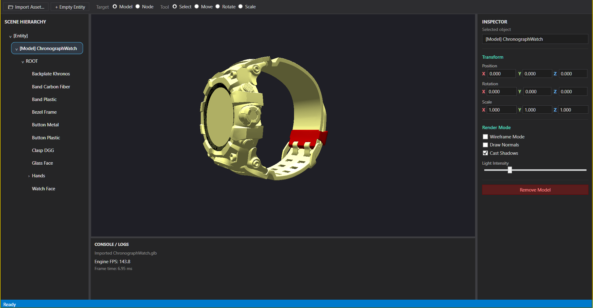

# Refactored OpenGL Engine

A C++17 OpenGL renderer with a .NET 8 WPF scene editor for Windows. Import static 3D models, build an entity hierarchy, attach cameras and lights, and edit the scene in a live viewport.

The project began as a standalone renderer and now includes a native engine DLL, a C# editor, and a CMake build workflow. Current development focuses on scene editing and picking performance.

## Editor preview



This earlier editor capture shows the imported hierarchy, model selection, transform fields, render controls, and native FPS in one view. The watch is a third-party sample asset; [credits and usage notes](#showcase-assets) are below.

[Watch the editor workflow](media/editor-camera-workflow.mp4) (32 seconds): import a model, select a node, change its transform, inspect it in wireframe, and remove the model. The recording is continuous and uses the Antique Camera sample asset.

## What you can do

- **Import multiple models.** Load assets through Assimp without changing source code. The import dialog includes OBJ, glTF, GLB, and FBX files; rendering support focuses on static meshes and their materials.
- **Inspect the model hierarchy.** Browse imported nodes, select a whole model or an individual node, and rename their labels in the editor.
- **Pick directly in the viewport.** Choose Model or Node as the picking target. Selection is reflected in the hierarchy and highlighted in the renderer.
- **Edit transforms.** Change position, rotation, and scale for a model or one of its nodes through the inspector.
- **Build an entity hierarchy.** Create empty entities, attach models, cameras, or lights, and parent entities in the hierarchy. Each entity currently supports one of each component type.
- **Edit cameras and lights.** Switch between an attached camera and the editor camera. Edit camera settings and adjust a light's type, color, intensity, direction, position, cone, and attenuation in the inspector.
- **Inspect geometry.** Toggle wireframe per model and move around the scene with the free-look camera.
- **Monitor the renderer.** View native render-loop FPS, average frame time, and import status in the editor's status bar.

The renderer supports diffuse/base-color, specular, and opacity textures, including compressed embedded textures such as PNG and JPEG. Its Blinn-Phong shader supports directional, point, and spot lights. The scene keeps an editor directional light and applies attached entity lights alongside it. Material settings do not yet have an editor inspector.

## Earlier renderer demo

These captures predate the WPF editor and show the standalone renderer's geometry handling.


[Watch the Stanford Lucy renderer demo](media/lucy-renderer-demo.mp4) (7 seconds).

## How it is built

The WPF application hosts a native Windows child window through `HwndHost`. C# calls exported C functions using P/Invoke, and the native engine owns the OpenGL context and dedicated render thread.

```text
WPF editor
  Hierarchy, inspector, import controls, viewport input
                         |
                  C# P/Invoke
                         |
                Native C bridge
                         |
                        Scene
           +--------------+--------------+
           |                             |
   Editor camera and light        Parent/child entities
                                         |
                              Optional model, camera, light
                                         |
                               Model nodes and meshes
                                         |
                              Materials and textures
                                         |
                                OpenGL draw calls
```

### Picking and transform updates

Picking first checks model and mesh bounds. For detailed meshes, the importer builds a triangle bounding volume hierarchy (BVH): triangle centroids are ordered with Morton codes, grouped into leaves, and enclosed by parent bounds. Traversal skips groups the ray cannot hit and tests triangles in the remaining leaves.

Rays are transformed into model and mesh space to intersect the stored geometry. Node transforms, inverse matrices, and mesh bounds are cached and rebuilt when node transforms change. The same transform cache is used by rendering and picking.

Viewport picking is dispatched outside the WPF UI thread, and large hierarchies are added in batches. Entity world transforms update their descendants and attached cameras. Camera and lighting uniforms are uploaded once per frame before drawing the models.

### Assets and memory

Models retain their node hierarchy and CPU vertex/index data for picking, alongside GPU buffers used for drawing. Repeated external texture references within one model reuse cached texture objects. Importing the same model again currently creates another model with its own data; there is no shared model asset cache yet.

### Main dependencies

| Area | Technology |
| --- | --- |
| Native engine | C++17, OpenGL, GLSL 330 |
| Editor | C#, .NET 8, WPF |
| Native viewport | Win32, WGL, `HwndHost` |
| Model import | Assimp |
| Math and image loading | GLM, stb_image |
| OpenGL function loading | GLAD |
| Build | CMake, Visual Studio 2022 / MSVC, vcpkg for Assimp |

## Build and run

### Requirements

- Windows x64 with a GPU and driver supporting OpenGL 3.3 or later.
- Visual Studio 2022 with **Desktop development with C++** and **.NET desktop development** installed. Include the MSVC v143 x64 build tools and a Windows SDK.
- The **.NET 8 SDK**. The editor targets `net8.0-windows`.
- CMake 3.24 or later if building Assimp from source or using the CMake alternative below.

GLAD, GLM, and stb_image are already included. Assimp headers and libraries must be supplied separately. The steps below use Release builds for the engine and its dependencies.

### Manual setup with Visual Studio

#### 1. Get the project

Clone the repository or download and extract its source archive. Open [refactored_engine_code.sln](refactored_engine_code.sln) in Visual Studio 2022. The solution contains two projects:

| Project | Produces |
| --- | --- |
| `refactored_engine_code` | The native engine DLL |
| `rendererUI` | The WPF editor executable |

Select **Release** and **x64** in the solution toolbar. Start with these configurations; `UI-debug` and `release2` are existing development configurations with different settings.

#### 2. Prepare Assimp

Use an Assimp build made with **Visual Studio 2022 / v143, x64, Release, and the dynamic C runtime (`/MD`)**. Headers and libraries must come from the same Assimp version. If you already have a matching static build, continue to step 3.

To build it yourself:

1. Download a release source archive from the [official Assimp repository](https://github.com/assimp/assimp), or clone it into a separate folder.
2. Open **CMake GUI**. Set the source directory to that Assimp folder and the build directory to a new folder, such as `assimp/build`.
3. Click **Configure**, choose **Visual Studio 17 2022**, and select **x64** as the platform.
4. Set the options below, then configure again until configuration completes.
5. Click **Generate**, then **Open Project**. In the generated solution, select **Release / x64** and build **ALL_BUILD**.
6. Build the **INSTALL** target in that same configuration to collect the headers and libraries under your chosen install prefix.

| Assimp CMake option | Value |
| --- | --- |
| `BUILD_SHARED_LIBS` | `OFF` |
| `USE_STATIC_CRT` | `OFF` |
| `ASSIMP_BUILD_ZLIB` | `ON` |
| `ASSIMP_BUILD_TESTS` | `OFF` |
| `ASSIMP_BUILD_ASSIMP_TOOLS` | `OFF` |
| `ASSIMP_BUILD_ASSIMP_VIEW` | `OFF` |
| `ASSIMP_BUILD_SAMPLES` | `OFF` |
| `ASSIMP_BUILD_DRACO` | `OFF` |
| `ASSIMP_INSTALL` | `ON` |
| `CMAKE_INSTALL_PREFIX` | A writable folder, such as `C:/dev/assimp-install` |

These options produce static Assimp/zlib libraries while using the dynamic MSVC runtime. The [Assimp build guide](https://github.com/assimp/assimp/blob/master/Build.md#cmake-build-options) describes the available switches.

#### 3. Place the dependency files

Create `dependencies/libs` if needed. Copy the installed `include/assimp` folder into `dependencies/include/assimp`. Use the installed headers so generated headers such as `config.h` are included.

Copy the Release Assimp and zlib libraries into `dependencies/libs`. Search the Assimp build/install folders for `assimp-vc143-mt.lib` and `zlibstatic.lib`; zlib may remain in the build tree instead of the install directory.

The resulting layout should include:

```text
dependencies/
   include/
     assimp/
       Importer.hpp
       scene.h
       config.h
       ...
     glad/               Already included
     KHR/                Already included
     glm/                Already included
     STB/                Already included
   libs/
     assimp-vc143-mt.lib
     zlibstatic.lib
```

If your Assimp release produces different library names, update the linker entries in the next step to use those exact names. Do not rename an incompatible library to make it match. No GLFW library is needed for the current WPF/WGL application.

#### 4. Check the native project settings

Right-click **refactored_engine_code → Properties**, with **Release / x64** selected. The checked-in project already supplies the following values; use this table if configuring a fresh project or resolving a local path issue. Keep inherited values when editing list properties.

| Property | Value |
| --- | --- |
| General → Configuration Type | Dynamic Library (`.dll`) |
| General → Platform Toolset | Visual Studio 2022 (`v143`) |
| C/C++ → Language → C++ Language Standard | ISO C++17 |
| C/C++ → General → Additional Include Directories | `$(ProjectDir)src;$(ProjectDir)dependencies\include` |
| C/C++ → Code Generation → Runtime Library | Multi-threaded DLL (`/MD`) |
| C/C++ → Language → OpenMP Support | Yes (`/openmp`) |
| Linker → General → Additional Library Directories | `$(ProjectDir)dependencies\libs` |
| Linker → Input → Additional Dependencies | `opengl32.lib;assimp-vc143-mt.lib;zlibstatic.lib;gdi32.lib;user32.lib` |

The Windows SDK supplies the OpenGL, GDI, and User32 import libraries. The engine project already compiles GLAD; no additional GLAD library is required.

#### 5. Build the engine and editor

1. Right-click **refactored_engine_code → Build**. The standard solution output is `x64/Release/refactored_engine_code.dll`; check the Build Output window for the actual path if you changed output settings.
2. Right-click **rendererUI → Set as Startup Project**.
3. Right-click **rendererUI → Build**. Under the checked-in solution mapping, its executable is `editor/bin/Release/net8.0-windows/rendererUI.exe`.
4. Confirm that `refactored_engine_code.dll` is beside that executable. The native project's Release post-build event copies it there. If you changed configurations or output paths, copy the newly built DLL into the editor's actual output folder manually.
5. Press **F5**, or run `rendererUI.exe` from that folder.

The solution maps `rendererUI` to **Any CPU**, but its project explicitly sets `PlatformTarget` to **x64**. The editor process and native DLL must both remain x64. Building the editor directly with `Platform=x64` instead produces an extra `x64` directory in its output path.

With the static Assimp/zlib setup above, those libraries are linked into the engine DLL. If you choose a shared Assimp build instead, its DLL and any dependent DLLs must also sit beside `rendererUI.exe`.

Keep the source checkout available: shader loading currently derives its paths from the compiled source location. Import a model through the editor after launch; no source-level model path is needed.

#### Debug builds

The native Debug configuration uses `/MDd`, while Release uses `/MD`. For a full Debug build, build Assimp and zlib in Debug too, point the engine's **Debug** linker settings at those libraries, and use their actual filenames (often with a debug suffix). Keep the configurations' libraries in separate folders. Debug and Release libraries are not interchangeable.

### Shorter alternative: CMake and vcpkg

This path configures dependencies and builds both projects without manually copying headers and libraries. It uses the [vcpkg manifest](vcpkg.json) to install Assimp.

If you do not already have vcpkg, clone it into a separate tools directory and bootstrap it on Windows:

```powershell
git clone https://github.com/microsoft/vcpkg.git C:/dev/vcpkg
& C:/dev/vcpkg/bootstrap-vcpkg.bat
```

From this project's root, configure, build, and launch:

```powershell
cmake --preset x64-release -DCMAKE_TOOLCHAIN_FILE="C:/dev/vcpkg/scripts/buildsystems/vcpkg.cmake" -DVCPKG_TARGET_TRIPLET=x64-windows
cmake --build --preset x64-release --target editor
& ".\editor\bin\x64\Release\net8.0-windows\rendererUI.exe"
```

Replace `C:/dev/vcpkg` with your own path. The `editor` target builds the native DLL and WPF application and copies the native runtime dependencies into the editor output folder. It explicitly builds the editor with `Platform=x64`, which explains the different output path from the manual solution build.

After configuration, the build itself is one command:

```powershell
cmake --build --preset x64-release --target editor
```

For Debug, configure with `x64-debug`, build with that same preset, and launch from the corresponding `Debug` directory. Use `--target refactored_engine_code` to build only the native DLL. If the `editor` target is missing, make sure `dotnet` is on `PATH` and rerun configuration.

### Common setup issues

| Symptom | What to check |
| --- | --- |
| Cannot open `assimp/Importer.hpp` or `assimp/config.h` | Copy the installed Assimp headers, and make sure the include path points to their parent `include` directory. |
| `LNK1104` for an Assimp or zlib library | Check the library directory and exact filename under the active configuration. |
| `LNK2038` runtime or iterator debug-level mismatch | Rebuild the dependency and engine with matching Release/Debug and `/MD` or `/MDd` settings. |
| `DllNotFoundException` | Check that the current engine DLL and any shared dependency DLLs are beside the editor executable. A missing dependency can cause this even when the engine DLL exists. |
| `BadImageFormatException` | Confirm that both the editor and all native libraries target x64. |
| `EntryPointNotFoundException` | Replace the editor's old engine DLL with the one just built from the same checkout. |
| Shader file errors after moving the executable | Keep the original source checkout and `src/shaders` available to the build. |

## Using the editor

1. Choose **Import Asset...** and open a local model. Keep external material and texture files with the asset.
2. Expand its hierarchy and select a model or node. The inspector shows its transform.
3. Edit the position, rotation, or scale fields, or toggle **Wireframe Mode** for the selected model.
4. Use the **Model / Node** target controls to choose what a viewport click selects. Clicking a hierarchy node selects that node directly.
5. Use **+ Empty Entity** to create an entity without a model. Imported models appear beneath their own entity rows.
6. Select an entity to attach a model, camera, or light. Select a camera or light row to edit its settings; the **Viewport** tab switches between the selected camera and the editor camera.
7. Drag one entity row onto another to change its parent, or onto empty hierarchy space to move it to the root.
8. Select an entity row and click **Delete Entity** to remove it. Select a model row and click **Remove Model** to keep the entity but remove its model. Node rows do not offer an inspector delete action; the hierarchy context menu can delete the owning entity.

With the viewport focused:

| Input | Action |
| --- | --- |
| `W` / `A` / `S` / `D` | Move forward / left / back / right |
| `Left Shift` / `Left Ctrl` | Move up / down |
| Hold right mouse button and move the mouse | Look around |
| Left mouse button | Pick a model or node |

## Current scope and limitations

This is an actively developed static model editor. Scene saving/loading and undo/redo are not implemented, so edits and renamed labels currently last for the editor session.

Large imports run synchronously on the native render thread and pause rendering. Operations waiting for scene access can also delay the UI. CPU geometry and BVH data remain in memory, and separate imports do not share model data. FPS and frame time describe the render loop, including presentation waits; they are not GPU-only timings.

Entity names are currently editor labels rather than saved scene data. Each entity can hold one model, camera, and light. The Move/Rotate/Scale tool buttons do not yet provide transform gizmos, and normal visualization and shadow controls are not connected. Skeletal animation, PBR shading, shadows, and scene frustum culling are not implemented.

The WPF editor's C# code will be refactored to consolidate repeated inspector and transform handling while preserving the current behavior.

## Repository layout

```text
editor/                 WPF application, hierarchy, and inspector
  Interop/              Native DLL declarations
  Viewport/             Hosted OpenGL viewport and input handling
src/
  host/                 C bridge, render thread, and Windows child window
  scene/                Scene, camera, and lights
  model/                Models, meshes, materials, textures, and triangle BVHs
  render/               Shader and OpenGL buffer wrappers, GLAD loader
  spatial/              Bounding boxes and ray helpers
  shaders/              GLSL source files
cmake/                  Runtime dependency copy helper
dependencies/           Vendored sources and optional local libraries
assets/                 Local development assets (ignored)
media/                  Editor and renderer showcase images and videos
```

The WPF application is the entry point. The former standalone `main.cpp` and GLFW window implementation have been retired.

## Showcase assets

- **Editor screenshot:** [Chronograph Watch from the Khronos glTF Sample Assets](https://github.com/KhronosGroup/glTF-Sample-Assets/blob/main/Models/ChronographWatch/README.md), credited there to Eric Chadwick for the model and textures. It builds on [Chronograph Watch Mudmaster by graphiccompressor](https://skfb.ly/oAsPA) and is licensed under [CC BY 4.0](https://creativecommons.org/licenses/by/4.0/). The sample includes Khronos, 3D Commerce, and DGG logos. Its material extensions are not fully supported by this renderer.
- **Editor workflow video:** [Antique Camera from the Khronos glTF Sample Assets](https://github.com/KhronosGroup/glTF-Sample-Assets/blob/main/Models/AntiqueCamera/README.md), credited to Maximillan Kamps / UX3D and released under [CC0](https://creativecommons.org/publicdomain/zero/1.0/). The model includes a UX3D logo on the tripod. The video shows the current editor's material rendering, which does not yet implement glTF metallic-roughness shading.
- **Earlier renderer captures:** Stanford Lucy from the [Stanford 3D Scanning Repository](https://graphics.stanford.edu/data/3Dscanrep/). Credit for the scan and reconstruction belongs to the Stanford Computer Graphics Laboratory.

The showcase models and textures are not included in this repository. Supply your own local assets to try the editor.

## License

MIT. See [LICENSE.txt](LICENSE.txt). Third-party dependencies and demonstration assets retain their own licenses.
